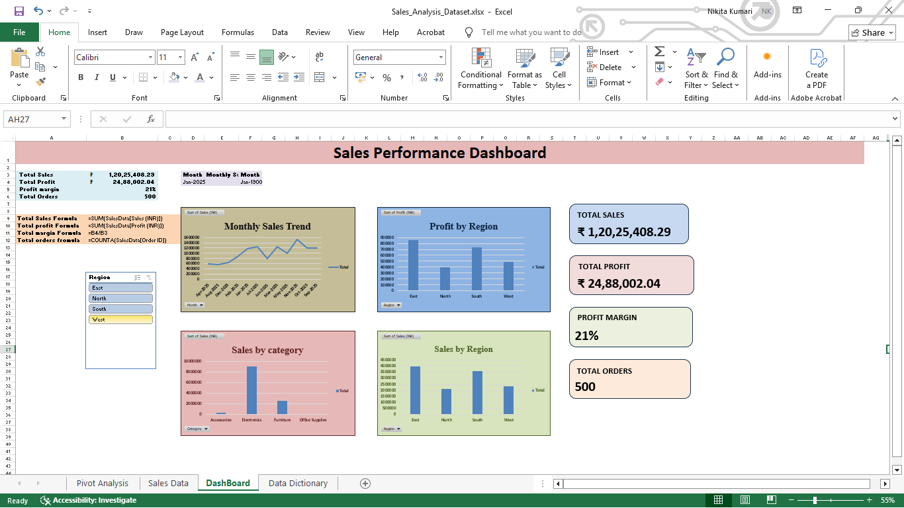

# Excel Sales Performance Dashboard

## Project Overview
An interactive Sales Performance Dashboard built using Microsoft Excel to analyze sales data and generate meaningful business insights.

## Tools Used
- Microsoft Excel
- PivotTables
- PivotCharts
- Slicers
- Excel formulas
- KPI Cards

## Key Features
- Total Sales KPI
- Total Profit KPI
- Profit Margin KPI
- Number of Orders KPI
- Monthly Sales Trend Analysis
- Sales by Region
- Profit by Region
- Sales by Category
- Interactive Region Slicer

## Dashboard Preview

## Key Learning Outcomes
- Data cleaning and preparation
- Creating PivotTables and PivotCharts
- Building interactive dashboards
- Connecting KPI cards to PivotTables
- Creating visual business reports

## Business Insights

- **Overall Performance:** The business generated total sales of ₹1,20,25,408.29 and total profit of ₹24,88,002.04.
- **Profitability:** The overall profit margin is approximately 21%.
- **Regional Performance:** East is the leading region in both sales and profit.
- **Category Performance:** Electronics is the highest-selling product category.
- **Interactive Analysis:** The Region slicer allows users to explore sales and profit performance across different regions.

## Conclusion

The dashboard provides an interactive view of business performance and helps identify important sales trends, profitable regions, and leading product categories.

## Author
Created as part of my Data Analytics learning journey.

